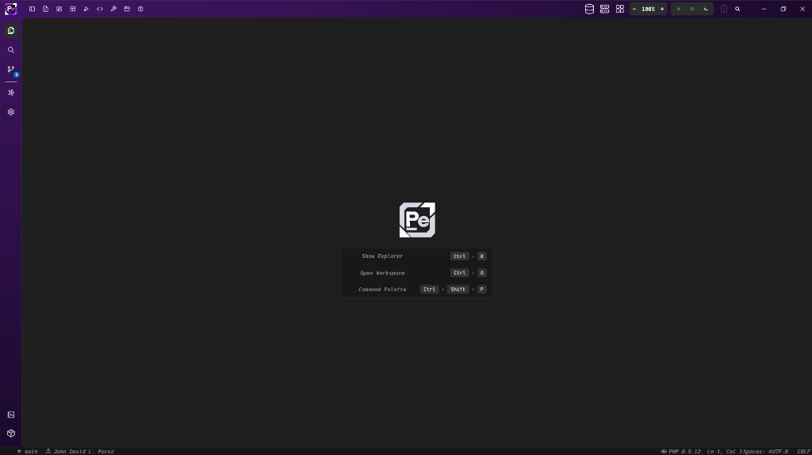
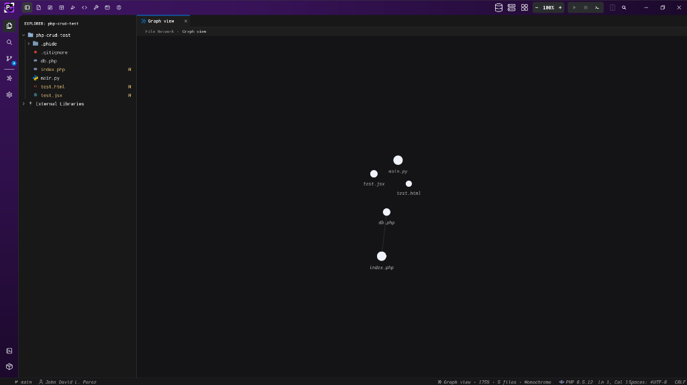
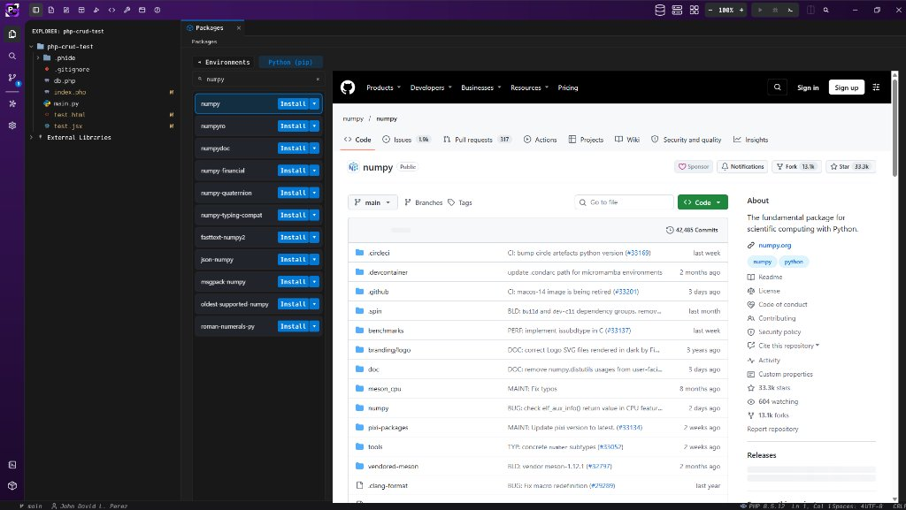

# phide — Modern High-Performance Desktop IDE

<p align="center">
  
</p>

<p align="center">
  <strong>Crafted with precision by Koda</strong>
</p>

<p align="center">
  
  
  
  
  
  
</p>

---

## Overview

**phide** is a high-performance native C++20 desktop IDE created by **Koda**. Engineered from the ground up on Direct2D and DirectWrite with zero Electron overhead, **phide** delivers instantaneous startup, sub-millisecond input responsiveness, and a sub-50MB memory footprint while offering rich modern IDE tooling for full-stack web and systems engineering.

---

## Visual Showcase

### Welcome & Workspace Interface
Clean, distraction-free desktop environment with custom title bar chrome, Windows 11 Snap Layouts, smooth sliding tool drawers, and quick command shortcuts.

<p align="center">
  
</p>

### Interactive Project Graph View
Real-time visual dependency and file connection network, mapping out project topology, cross-file imports, and project structure dynamically.

<p align="center">
  
</p>

### Built-in Package Manager
Integrated multi-ecosystem package management for Python (pip), Node.js, and PHP with live search, one-click installation, and live documentation preview.

<p align="center">
  
</p>

---

## Core Features

- **Blazing Native Performance**:
  - 100% C++20 desktop application built directly on Direct2D and DirectWrite.
  - Sub-50MB RAM usage — no Chromium, no Electron, no heavy web engine wrappers.
  - Sub-millisecond keystroke rendering latency with hardware GPU acceleration.

- **Integrated Prettier & PSR-12 Formatter**:
  - Bundled offline Prettier formatting engine for JavaScript, TypeScript, JSX, TSX, HTML, CSS, SCSS, LESS, JSON, YAML, and Markdown.
  - Native PSR-12 coding standard formatter for pure and mixed PHP files.
  - Keyboard trigger: `Shift+Alt+F` / `Ctrl+K Ctrl+F`.

- **Deterministic Semantic Commit Engine**:
  - Native Conventional Commit generator that dynamically analyzes Git diff hunks and AST scopes without LLMs, internet access, or memory overhead.
  - Generates accurate, contextual messages (e.g. `feat(Test): update JSX render return in Test component`).

- **Interactive File Topology (Graph View)**:
  - Visual node network illustrating project files and their architectural relationships.

- **Integrated Package Management**:
  - Search, install, and manage Python virtual environments, pip packages, and project dependencies directly inside the editor with embedded documentation preview.

- **Visual Git & Source Control**:
  - Split-view side-by-side diff inspector (`Working Tree` vs `HEAD`).
  - Git commit history graph, visual branch switching, discard/stage operations, and blame annotations.

- **Theme & Customization System**:
  - Comprehensive 13-theme color engine (Dark Modern, Light Modern, Widescreen, Catppuccin, Nord, Tokyo Night, Monokai, and High Contrast).
  - Customizable fonts, editor zoom, tab size, and line height settings.

---

## Directory Overview

```
phide/
├── assets/                 # Fonts, icons, and bundled extensions (Prettier, ESLint, etc.)
├── bin/                    # Output binaries and runtime assets
├── docs/                   # Documentation and screenshots
│   └── images/             # Visual assets and Koda branding
├── include/phide/          # C++20 interface headers
│   ├── app/                # Application window, configuration, and event routing
│   ├── editor/             # Text buffer, format engine, syntax validators, AST analyzers
│   ├── ui/                 # Direct2D UI components, drawers, modals, graph views
│   └── workspace/          # File system, project tree, and workspace management
├── installer/              # Standalone offline installer packaging scripts
├── scripts/                # Build and test automation scripts
├── src/                    # C++20 implementation sources
└── tests/                  # Verification and integration test suite
```

---

## Building & Running

### Requirements
- **OS**: Windows 10 / 11 (x64)
- **Compiler**: Visual Studio 2022 (MSVC with C++20 workload)
- **Runtime**: Node.js (for bundled Prettier formatter CLI)

### Build Commands
Open PowerShell or Developer Command Prompt in the project root:

```powershell
# 1. Build phide executable
.\scripts\build.bat

# 2. Run the test verification suite
.\scripts\build_test.bat && .\bin\test_verification.exe 117
```

---

## Standalone Offline Installer

To package the standalone installer containing all runtimes, web servers, database engines, and extensions:

```powershell
.\installer\build_installer.bat
```

The resulting single-file setup executable will be located at:
`installer\output\phide-Setup-x64.exe`

---

## Authors & Credits

**phide** is designed and developed by **Koda**.

<p align="center">
  
</p>
