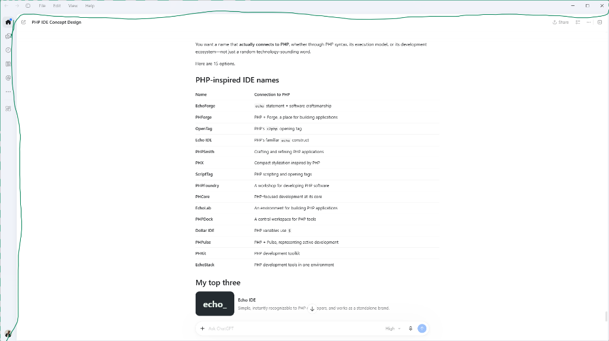

# phide — Modern Lightweight C++ IDE



**phide** is a high-performance, modern native C++ IDE featuring a clean, distraction-free frameless window, integrated header navigation, and a collapsed 52px activity rail with smooth slide-out tool drawers.

---

## Key Highlights

- **Frameless Window Chrome**: Custom Windows 11 title bar integration supporting native Snap Layouts, window dragging, and border resizing.
- **Top Header Bar**:
  - History back/forward navigation (`←`, `→`).
  - Integrated menu bar (`File`, `Edit`, `View`, `Help`).
  - Document / workspace pill (`PHP IDE Concept Design`) with edit icon.
  - Quick action cluster: `Share`, Split View / Sidebar toggle, `...` overflow, and native caption buttons.
- **Collapsed Activity Rail (52px Left Sidebar)**:
  - Top cluster: Home / Welcome badge, AI Assistant chat, Git History & commits, Project File Explorer, Context & `@` Symbols, and More actions.
  - Bottom cluster: Extensions / Layout grid (`4-squares`), and User Avatar circle.
  - Interactive state: Click an icon to smoothly expand the contextual drawer (280px); click it again to collapse back to the rail.
- **Main Workspace & Floating AI Bar**:
  - High-performance Direct2D/DirectWrite code editor canvas with line numbers and syntax coloring for PHP & C++.
  - Floating modern bottom prompt pill (`+ Ask AI`, model selector `High ▾`, microphone, and submit button).
- **Extensible Language Core**:
  - Multi-language LSP readiness for both PHP (`intelephense` / `phpactor`) and C++ (`clangd`).

---

## Directory Overview

```
phide/
├── include/phide/       # C++20 Interface Headers
│   ├── app/             # Application lifecycle, window chrome, and DPI handling
│   ├── ui/              # TitleHeader, ActivityRail, DrawerPanel, EditorCanvas, FloatingPromptBar
│   ├── editor/          # Text buffer, line indexing, and syntax tokenization
│   ├── lsp/             # Language Server Protocol client interface
│   └── workspace/       # Project explorer and file tree management
├── src/                 # C++20 Implementation Sources
├── docs/                # Architecture, Folder Structure, and UI Specifications
└── scripts/             # One-click MSVC build and run scripts
```

For full details, see:
- [Folder Structure Guide](docs/FOLDER_STRUCTURE.md)
- [System Architecture](docs/ARCHITECTURE.md)
- [UI & Visual Specification](docs/UI_SPECIFICATION.md)

---

## Building & Running

### Requirements
- Windows 10/11 (x64)
- Microsoft Visual C++ (MSVC 2022) with C++20 support

### One-Click Build & Launch
Open PowerShell or Command Prompt in the repository root:

```powershell
# Build the native binary
.\scripts\build.bat

# Launch the IDE
.\scripts\run.bat
```
